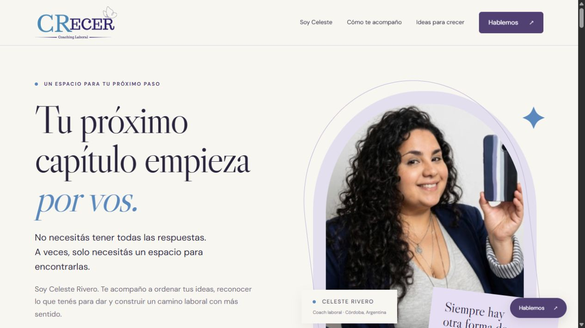

# CRecer · Celeste Rivero

**Espacio de coaching laboral y desarrollo profesional con publicaciones, recursos y formas de contacto.**

[](https://github.com/GermanBartoli/crecer-coach-laboral)
[](https://github.com/GermanBartoli/crecer-coach-laboral/actions/workflows/cloudflare.yml)

[Abrir sitio](https://crecer-coach-laboral.pages.dev/) · [Empezar](#primeros-pasos) · [Mapa del repositorio](#mapa-del-repositorio) · [Autoría](#autoría-de-esta-documentación)



*Captura de la página publicada, tomada el 9 de noviembre de 2026. Conservada sin redimensionar ni recomprimir.*

## Primeros pasos

1. Recorré Soy Celeste y Cómo te acompaño para conocer la propuesta.
2. Abrí Ideas para crecer para leer textos, recorrer carruseles y reproducir los reels.
3. Usá Hablemos para elegir la vía de contacto. Las publicaciones se mantienen desde `content.json`, sin sincronización automática con las redes.

## Enlaces

- [Sitio publicado en Cloudflare Pages](https://crecer-coach-laboral.pages.dev/)
- [Repositorio en GitHub](https://github.com/GermanBartoli/crecer-coach-laboral)

Landing de coaching laboral y desarrollo profesional. Identidad y contenidos de Celeste Rivero; repositorio administrado por German Bartoli.

## Sitio

Publicado en Cloudflare Pages: [CRecer · Celeste Rivero](https://crecer-coach-laboral.pages.dev).

## Contenido

- Presentación, servicios, proceso de acompañamiento y trayectoria comprobada en el perfil de LinkedIn.
- Las 15 publicaciones de Instagram distribuidas en tres secciones: cinco ilustraciones, cuatro reflexiones y seis publicaciones restantes.
- Carruseles de imágenes con controles, flechas de teclado, gesto táctil y cierre con Escape.
- Diez textos de LinkedIn con lector interno y enlaces a la red.
- Dos escenas editoriales generadas para las secciones de claridad y conversación.
- WhatsApp, mapa de la zona centro de Córdoba y formulario conectado a FormSubmit con destino a crecer.coaching.cr@gmail.com. El destinatario debe confirmar el correo de activación de FormSubmit para recibir consultas.

## Desarrollo

Sitio estático sin dependencias de ejecución. Requiere Node.js para preparar la distribución.

```sh
pnpm run check
pnpm test
pnpm run build
pnpm run dev
```

El servidor local utiliza `http://127.0.0.1:4317`.

## Estructura

| Archivo | Contenido |
| --- | --- |
| `index.html` | Secciones, metadatos, formulario y mapa |
| `styles.css` | Diseño adaptable, tipografía y estados |
| `script.js` | Publicaciones, lector, carruseles y menú |
| `content.json` | Textos, imágenes y enlaces de publicaciones |
| `assets/` | Imágenes locales y favicon |
| `scripts/build.js` | Copia explícita de archivos públicos a `dist/` |
| `wrangler.jsonc` | Configuración de Cloudflare Pages |

## Actualización de publicaciones

Editar `content.json` y agregar las imágenes a `assets/`. No hay sincronización automática ni uso de credenciales de redes sociales en la página. Los materiales de investigación quedan fuera de Git y de la distribución.

## Alcance del material

Captura editorial realizada el 24 de octubre de 2026. Se incluyen los siete reels completos en MP4 para reproducirlos dentro del sitio, además de sus portadas, textos y enlaces al original en Instagram. Se recuperaron 2, 2, 3 y 3 imágenes de los cuatro carruseles de reflexiones. Los documentos multipágina de LinkedIn no se replicaron íntegramente. Para seis textos sin enlace individual recuperado, el botón dirige a la actividad de Celeste y lo indica expresamente. Las cuatro publicaciones destacadas conservan enlaces directos.

No se afirma haber importado la mayoría del archivo histórico completo de LinkedIn. Se incluyeron diez textos propios recuperados y tres imágenes asociadas. No se publicaron búsquedas laborales de terceros ni sus datos de contacto.

## Publicación

Cada push a `main` ejecuta `.github/workflows/cloudflare.yml`: verifica la sintaxis, ejecuta las pruebas, compila y publica en el proyecto existente `crecer-coach-laboral`. El token se guarda en el secreto de GitHub Actions `CLOUDFLARE_API_TOKEN`. También admite ejecución manual.

```sh
pnpm dlx wrangler pages deploy dist --project-name crecer-coach-laboral --branch main
```

El dominio `crecer.dev` no estaba configurado en la cuenta de Cloudflare consultada. No se compró ni se registró ningún dominio. La dirección de publicación es la gratuita de Pages.

## Propiedad

© 2026 Celeste Rivero. Todos los derechos reservados. Las marcas de terceros conservan su titularidad. La atribución del sitio a Celeste no implica una transferencia de la cuenta de GitHub o Cloudflare.

## Mapa del repositorio

- [package.json](<package.json>)
- [content.json](<content.json>)
- [index.html](<index.html>)
- [docs/PUBLICACION.md](<docs/PUBLICACION.md>)

## Autoría de esta documentación

Repositorio mantenido por [Germán Bartoli](https://github.com/GermanBartoli). Guía revisada y actualizada con **Codex**, coautor de esta actualización documental. Los autores, colaboradores, licencias y recursos de terceros conservan sus créditos originales.

Los commits de esta revisión incluyen `Co-authored-by: Codex <noreply@openai.com>`; esta atribución no modifica la autoría del historial anterior.

<!-- firma-german-bartoli -->
<p align="center">
  <a href="https://germanbartoli.pages.dev/">
    <br />
    Hecho por Germán Bartoli · Ver portfolio
  </a>
</p>
